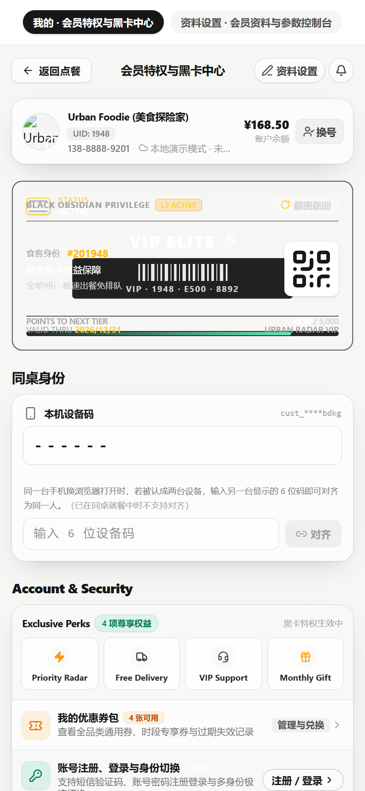
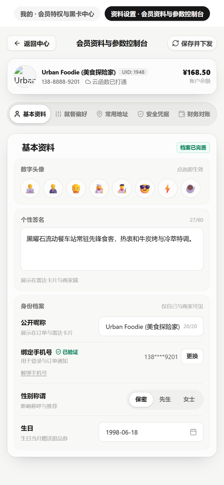
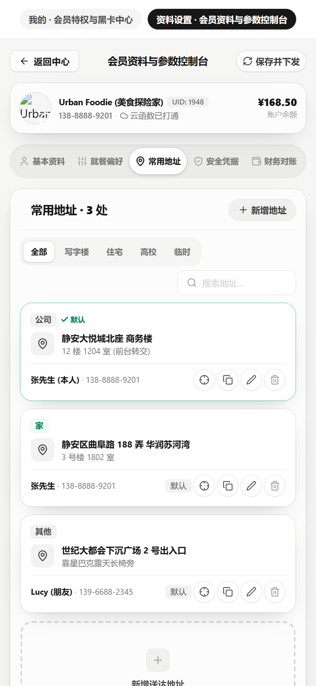
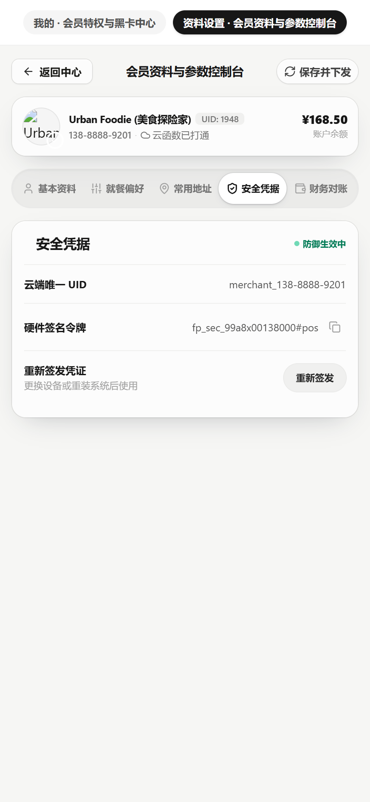
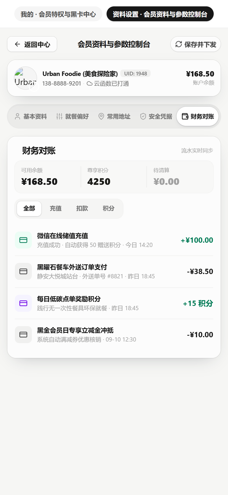

# UrbanRadar · 会员中心界面源码

从 [urban-radar-food-truck](https://github.com/sfuu0001/urban-radar-food-truck)（流动餐车平台，食客端）中
抽取的两个界面的独立运行工程：

| 界面 | 组件 | 入口 |
|---|---|---|
| 我的 · **会员特权与黑卡中心** | `src/components/ProfilePageView.tsx`（945 行） | 底部导航「我的」 |
| 资料设置 · **会员资料与参数控制台** | `src/components/user/UserProfileEditView.tsx`（1387 行） | 「我的」页右上「资料设置」 |

两个组件 **逐行原样**，未做任何改写；为使其脱离主工程可运行，
云服务 / 短信 / 设备指纹等外部依赖换成了**同签名本地实现**（见 `src/utils/*`，
每个文件头部注明了它替换的原模块与差异）。

## 预览

| 我的 · 会员特权与黑卡中心 | 资料设置 · 会员资料与参数控制台 |
|---|---|
|  |  |

资料设置的其余分区：

| 常用地址 | 安全凭据 | 财务对账 |
|---|---|---|
|  |  |  |

就餐偏好分区见 `docs/preview/edit-pref.png`。

## 运行

```bash
npm install
npm run dev      # http://localhost:5190
npm run build    # 产物在 dist/
```

页面顶部是演示壳的切换条（非界面本体），可在两个界面间切换。
界面按 **430px 移动端宽度** 设计，建议用浏览器设备模拟器或手机打开。

## 目录结构

```
src/
├─ components/
│  ├─ ProfilePageView.tsx        ← 界面 1（原样）
│  ├─ user/UserProfileEditView.tsx ← 界面 2（原样）
│  ├─ user/UserAuthModal.tsx     ← 账号注册/登录弹层（原样，被界面 1 引用）
│  ├─ UserCouponsModal.tsx       ← 优惠券包弹层（原样）
│  ├─ DeviceIdentityCard.tsx     ← 设备身份卡（原样）
│  └─ ui/ToastContext.tsx        ← 全局 toast（原样）
├─ context/DevSimulationContext.tsx ← 演示上下文（原样）
├─ data/                          ← 初始档案 / 优惠券种子数据（原样）
├─ types.ts + types/              ← 类型定义（原样）
├─ utils/
│  ├─ safeStorage.ts             ← localStorage 安全封装（原样）
│  ├─ useCardScrollReveal.tsx    ← 卡片滚动入场动画（原样）
│  └─ *.ts                       ← 其余为同签名替身，见下表
├─ App.tsx                       ← 演示宿主（切换两个界面）
└─ main.tsx
```

## 替身模块对照

| 本工程文件 | 替换的主工程模块 | 行为差异 |
|---|---|---|
| `utils/wbCloud.ts` | `utils/wbCloud.ts`（WorkBuddy 云 SDK 初始化） | `wbDb.from(...)` 返回链式 thenable，恒 `{data:[], error:null}`，不发起网络请求 |
| `utils/cloudbase.ts` | `utils/cloudbase.ts`（腾讯云开发 + TCB 回退层） | `TCB_CLOUD_ENABLED=false`；`syncUserProfileToCloud` 直接本地保存并锁定余额/积分/等级 |
| `utils/smsService.ts` | `utils/smsService.ts`（自建 /auth 网关 + 短信通道） | 演示模式：验证码固定 `123456`，注册/登录/换绑全部本地成功 |
| `utils/couponEngine.ts` | 842 行完整引擎 | 只保留 `getUserCouponRecords / saveUserCouponRecords`（localStorage 存取） |
| `utils/truckLocationEngine.ts` | 800 行门店/配送引擎 | 只保留 `DeliveryAddressItem` + `saveAddresses` |
| `utils/deviceFingerprint.ts` | 真实硬件指纹采样 | 返回稳定假指纹，字段形状一致 |
| `utils/autoAuthEngine.ts` | 设备令牌自动登录 | 恒返回「无自动登录」 |
| `utils/identityBinding.ts` / `deviceIdentity.ts` | 云端同桌身份体系 | 本地生成并固化 6 位设备码 |
| `utils/versionPurgeGateway.ts` | 发版清理网关 | 仅提供版本常量与「本地强刷 = 清 sessionStorage 后刷新」 |
| `utils/cloudUserSync.ts` | 云端用户同步 | 退出登录只清本地 |

界面本体若要接回主工程，直接把 `components/` 下的原样文件拷回即可，
替身模块不会被带入（主工程用自己的真实实现）。

## 界面 1：我的 · 会员特权与黑卡中心

- 会员卡（黑卡质感、可点击翻面：正/反面）、等级与积分进度
- 账户余额、优惠券包入口、同桌身份设备码（复制 / 对齐）
- 尊享权益矩阵、账号注册登录入口（AUTH）
- 本地强刷、演示模式标识

## 界面 2：资料设置 · 会员资料与参数控制台

5 个分区（分段控件导航）：

1. **基本资料** —— 头像、昵称、性别、生日、签名（两列布局）
2. **就餐偏好** —— 辣度、忌口标签、口味偏好
3. **收货地址** —— 地址增删改、地标快捷选择、默认地址
4. **安全与账号** —— 手机号换绑（短信验证码）、密码设置、设备信息
5. **财务与钱包** —— 余额明细、消费能力档位

## License

仅供学习与内部演示，与主工程同源同许可。
